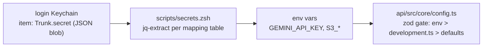

# Secrets Workflow

> **Scope: local development only.** This workflow is for a single developer
> machine running dev servers. It is **not** a production secrets strategy and
> must never be used to provision deployed environments, CI, or teammates —
> see [What this is not](#what-this-is-not).

How local dev secrets are stored, loaded, and rotated for Trunk. The rule set:

1. Real secret values never touch the repo — no `.env`, no config files, no source.
2. Secrets live in the **macOS login Keychain** as one JSON blob per trust domain.
3. Code receives secrets as **env vars** ([api/src/core/config.ts](../api/src/core/config.ts) is the single zod validation gate).
4. One terminal command loads them; one dialog (at most) ever prompts.

## Architecture

- **One keychain item per project** (`Trunk.secret`), holding a minified JSON object. One item = one unlock surface, one ACL to manage. A *new* item is justified only by a distinct trust domain or rotation schedule, not by secret count.
- **[scripts/secrets.zsh](../scripts/secrets.zsh)** is the committed, secrets-free mapping table (`ENV_VAR_NAME → JSON key`). It is the canonical inventory of which secrets this project needs — there is intentionally no `.env.example`.
- **`jq`** does the parsing (`brew install jq`, once per machine).
- **No shell customization is required.** Store/rotate are copy-paste blocks
  from this document; daily loading is `source scripts/secrets.zsh` (or the
  parenthesized form below). An optional `trunk-dev` alias is the only thing
  you might choose to add to `~/.zshrc`.

## What this is not

This document deliberately stops at the local-dev boundary. It does **not**
cover, and its mechanisms must not be reused for:

- **Production / deployed environments** — a server has no macOS Keychain and no
  interactive prompt. Production secrets belong in a managed store (AWS Secrets
  Manager, SSM Parameter Store, etc.) injected by the deploy platform, with
  IAM-scoped access and provider-side rotation.
- **CI** — pipelines take secrets from the CI provider's secret storage
  (e.g. GitHub Actions secrets), never from a developer keychain.
- **Team distribution** — the Keychain is per-machine, per-user; there is no
  sharing story here by design. A second developer provisions their own blob
  from the team-approved secure channel.
